 Me dedico a construir aplicaciones completas:
desde los requerimientos, la arquitectura, el modelado de datos, el frontend y el backend.

- En desarrollo: **Entrópica**, aplicación web SaaS, B2B para gestión y dimensionamiento de proyectos fotovoltaicos (React + FastApi + postgresql).
- Educación: **LeitnerApp**, una app de estudio con repetición espaciada (React + Express + MongoDB)
- Stack: TypeScript · Java / Spring Boot · Python / PySpark · SQL · MongoDB · Docker · Kubernetes
- [LinkedIn](https://www.linkedin.com/in/gastonnicolasruiz)

## Proyectos destacados
- [Entrópica](https://github.com/GastonNer/entropica-frontend): frontend en React + Typescript con atomic design con CAD 2D y 3D integrado para imágenes satelitales.
- [LeitnerApp](https://github.com/GastonNR/leitnerApp_frontend): frontend en React 19 con atomic design + API REST con JWT
- [RetroScope](https://github.com/GastonNR/retroScope_spring_boot): sistema gestor de cines en Spring Boot 3
- [Clúster Spark](https://github.com/GastonNR/script_cluster_spark_docker): Apache Spark con 3 workers en Docker Compose
